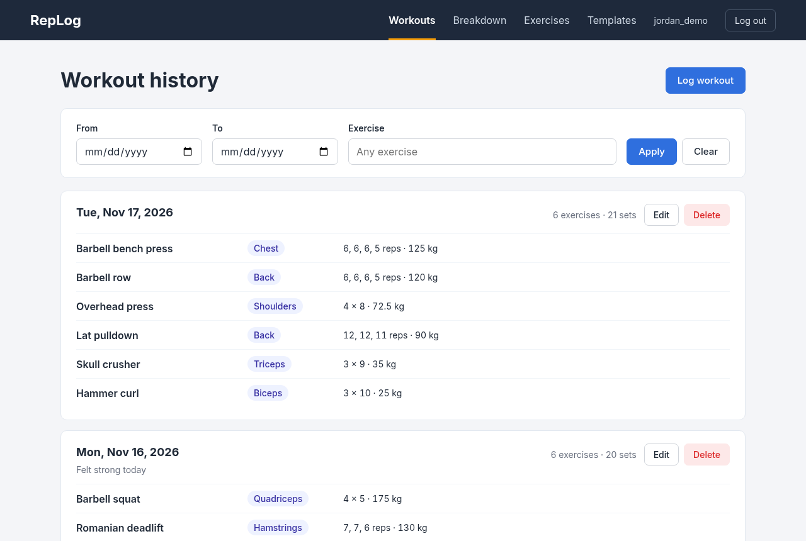
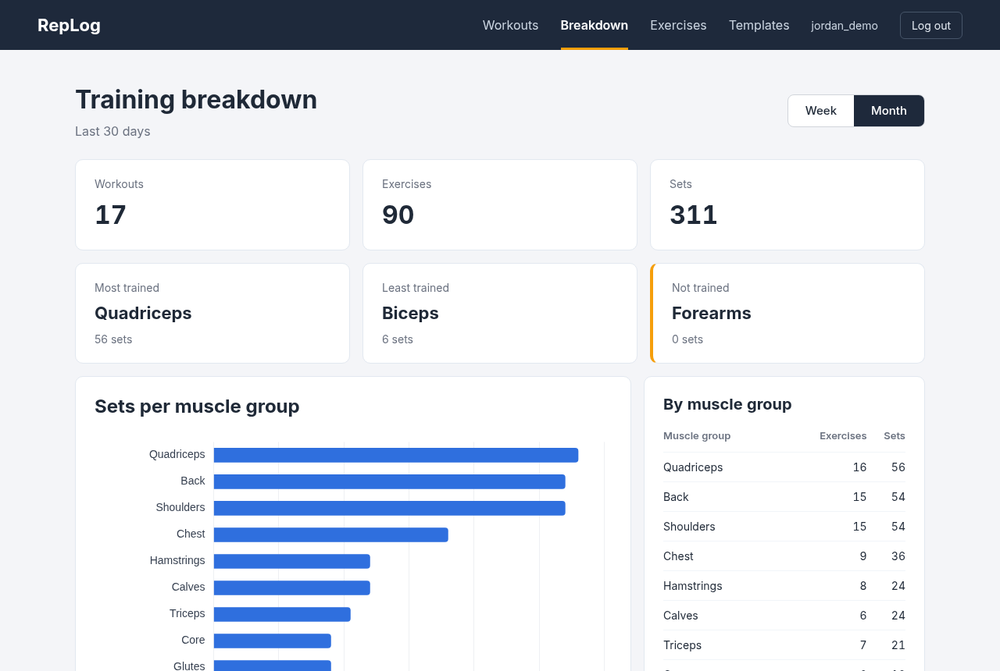
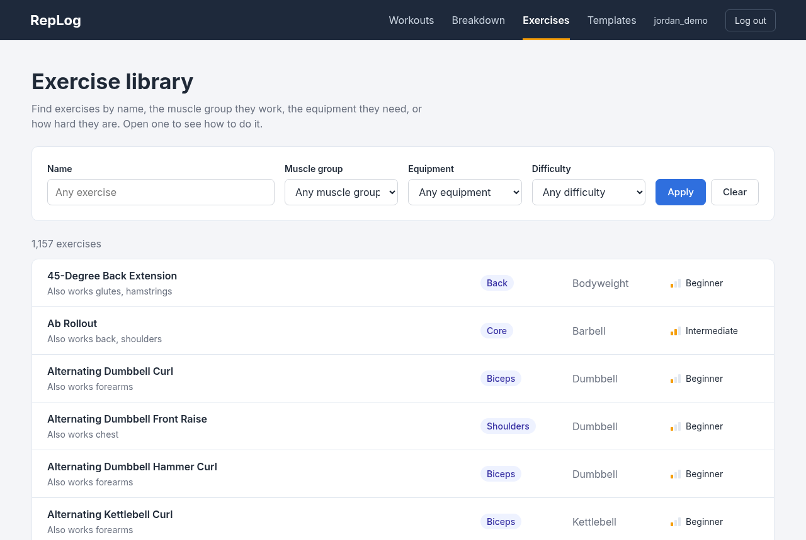
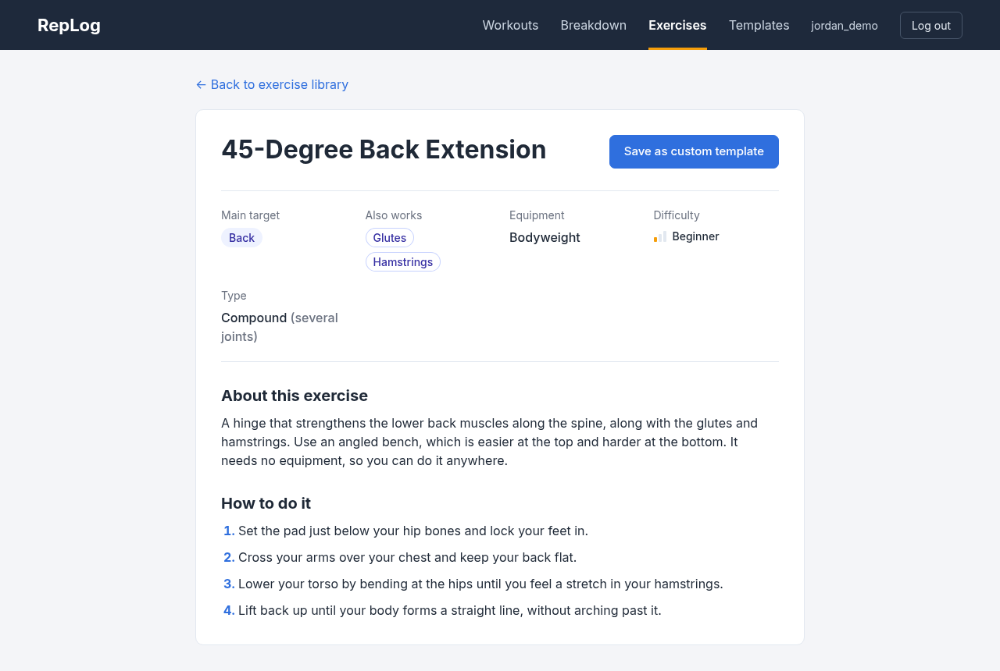
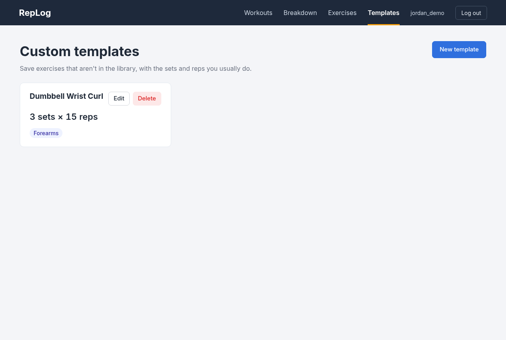

# RepLog

A gym companion for logging workouts, seeing which muscle groups your training covers and which it misses, and browsing an exercise library to fill the gaps.

**Live app:** https://rep-log-sable.vercel.app

**Demo account:** username `jordan_demo`, password `replog-demo` (two years of upper/lower training history)











## Authors

- **Ashwin Bhat** ([@ashwin-bhat-neu](https://github.com/ashwin-bhat-neu)): authentication, workout log, workout history filters, and training breakdown (`users`, `sessions`, and `workouts` collections, API, and pages)
- **Mohammed Sameer Sarfaraz Bake** ([@sameer08055](https://github.com/sameer08055)): exercise library, exercise detail, and custom templates (`exercises` and `customTemplates` collections, API, and pages)

## Class

[CS 5610 Web Development (Online), Fall 2026](https://johnguerra.co/classes/webDevelopment_online_fall_2026/index.html), Northeastern University Oakland, taught by John Alexis Guerra Gómez.

## Project objective

Notes apps don't know what a set is, and most fitness apps bury logging under subscriptions and social feeds. Lifters who follow a split also tend to lose track of which muscle groups they're neglecting. RepLog has two parts:

- **Workout log and training breakdown:** log each session's exercises, sets, reps, and weights; filter past workouts by date range and exercise to follow progress on a lift; and see sets and exercises per muscle group for the last week or month, including the groups that got no work.
- **Exercise library and custom templates:** search 1,157 exercises by name, muscle group, equipment, and difficulty; open one for its instructions; and save exercises as custom templates with default sets and reps.

The [design document](docs/design-document.md) has the personas, user stories, data model, API, and mockups.

## How to use it

Register an account, or log in with the demo account above. The exercise library is public; everything else requires logging in.

### Workouts

1. Open **Workouts** and click **Log workout**. The date defaults to today.
2. Add each exercise with its muscle group, then its sets. **+ Add set** copies the previous set, and leaving the weight empty means bodyweight. Click **Save workout**.
3. Past workouts are listed newest first. Use **From**, **To**, and **Exercise** to narrow the list; with an exercise filter, each card shows only the matching exercises, so a lift's progress reads down the page.
4. **Edit** opens a workout in the same form; **Delete** asks for confirmation first.

### Breakdown

1. Open **Breakdown** to see the last 30 days, or click **Week** for the last 7.
2. The tiles show workouts, exercises, and sets, followed by the most trained, least trained, and untrained muscle groups.
3. The chart and the table show sets per muscle group, most to least.

### Exercises

1. Open **Exercises** and search by name, or filter by muscle group, equipment, and difficulty, then click **Apply**.
2. Click an exercise to see its main target, the other muscles it works, its equipment and difficulty, and how to do it.

### Templates

1. On an exercise's page, click **Save as custom template**. The name and target muscle groups are filled in; set the default sets and reps and save.
2. To add an exercise the library doesn't have, open **Templates** and click **New template**.
3. **Edit** and **Delete** on each template card work like they do for workouts.

## Tech stack

- **Frontend:** React 19 with hooks, React Router, PropTypes, Chart.js, and the Fetch API, built with Vite
- **Backend:** Node.js 22 and Express 5, using ES modules
- **Authentication:** Passport with the local strategy and `express-session`, with sessions stored in MongoDB and passwords hashed with scrypt
- **Database:** MongoDB Atlas with the native Node.js driver
- **Hosting:** Vercel, with the frontend and API served from the same origin
- **Tooling:** ESLint and Prettier

## Build and run locally

Requires Node.js 22 and a MongoDB connection string. A free MongoDB Atlas cluster works.

```bash
git clone https://github.com/ashwin-bhat-neu/rep-log.git
cd rep-log
cp backend/.env.example backend/.env       # then fill in MONGODB_URI and SESSION_SECRET
npm install --prefix backend
npm install --prefix frontend
npm run seed:exercises --prefix backend    # optional: loads the exercise library
npm run seed:workouts --prefix backend     # optional: creates the demo accounts and their workouts
npm run dev --prefix backend               # API at http://localhost:3000
npm run dev --prefix frontend              # app at http://localhost:5173, forwards /api to the API
```

`GET /api/health` confirms the database connection.

To try the production build, keep the API running, then run `npm run build --prefix frontend` and `npm run preview --prefix frontend`. The app runs at http://localhost:4173.

| Script (in `backend/`)   | What it does                                               |
| ------------------------ | ---------------------------------------------------------- |
| `npm run dev`            | Starts the API                                             |
| `npm run seed:exercises` | Replaces the exercise library                              |
| `npm run seed:workouts`  | Creates the five demo accounts and replaces their workouts |
| `npm run lint`           | Runs ESLint                                                |
| `npm run format`         | Formats every file with Prettier                           |
| `npm run format:check`   | Checks formatting without changing files                   |

The frontend has the same `dev`, `lint`, `format`, and `format:check` scripts, plus `build` and `preview`.

### Demo data

`seed:workouts` creates five demo accounts, all with the password `replog-demo`: `arjun_demo`, `maya_demo`, `jordan_demo`, `priya_demo`, and `sam_demo`. Each follows a different program over 16 to 104 weeks, and some skip certain muscle groups so the breakdown has gaps to show. The workouts end on the day the script runs, so run it again to bring the week and month views up to date. It only replaces the demo accounts' workouts.

## Deploying

The app deploys to Vercel as one project with two [services](https://vercel.com/docs/services), configured in `vercel.json`: requests under `/api/` go to the Express backend, and everything else goes to the React frontend.

1. In MongoDB Atlas, create a database user and allow network access from `0.0.0.0/0`.
2. Import the GitHub repository into Vercel and choose the Services preset.
3. Add `MONGODB_URI` and `SESSION_SECRET` environment variables, then deploy.

## API

The routes are listed in the [design document](docs/design-document.md#authentication-api). The exercise library is public. Workouts, the training breakdown, and custom templates require a logged-in session, and each user can only read or change their own.

## Project structure

```
backend/
  src/
    app.js, server.js    Express app (exported for Vercel) and local server
    authentication/      Passport setup, password hashing, and the MongoDB session store
    database/            MongoDB connection and collection queries
    domain/              Muscle groups and the training breakdown calculation
    routes/              Express routers
    middleware/          Authentication check and JSON error handlers
    validation/          Request validation, independent of the database
  scripts/               Seed data for the exercise library and demo accounts
frontend/
  src/
    pages/               One folder per page, with its CSS
    components/          One folder per component, with its CSS
    api/                 Fetch wrappers for each API
    context/, hooks/     Logged-in user context and the API request hook
    utilities/           Dates, set summaries, and form state helpers
docs/                    Design document
assets/images/           Mockups
assets/screenshots/      Screenshots of the deployed app
```

## Links

- [**Presentation Video**](https://youtu.be/agnKJ68IlaA)

## License

[MIT](LICENSE)
